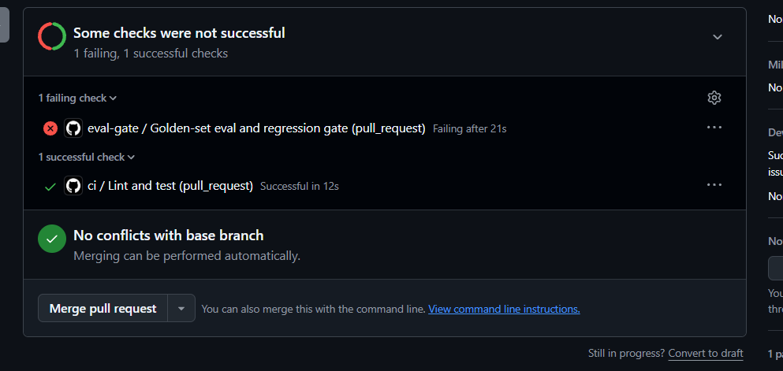
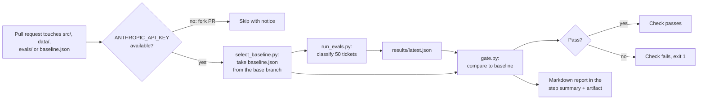

# llm-eval-gate

[](https://github.com/mwaseemUC/llm-eval-gate/actions/workflows/ci.yml)
[](https://github.com/mwaseemUC/llm-eval-gate/actions/workflows/eval-gate.yml)
[](LICENSE)

An LLM classifier for SaaS support tickets, a 50-ticket hand-reviewed golden set, and a GitHub Actions
gate that fails a pull request when accuracy drops more than 3 points against the base branch.

**Result:** a PR that cut the prompt's input tokens by 51% to "save cost" dropped accuracy from 100% to 90%,
and the gate blocked it. Caching meant the PR saved no money: the full eval cost $0.0038 before and $0.0040 after.

| [PR #1](https://github.com/mwaseemUC/llm-eval-gate/pull/1): "Trim classifier prompt to cut input tokens ~50%" | Accuracy | Macro-F1 | Input tokens / run | Cost / run | Gate |
|---|---:|---:|---:|---:|---|
| Baseline: prompt `v2` (`main`) | 100.0% | 1.000 | 120,118 | $0.0038 | - |
| PR: prompt `v3-trimmed` | 90.0% | 0.898 | 58,368 | $0.0040 | **FAILED**: "Accuracy dropped 10.0 pts (100.0% -> 90.0%), limit is 3.0 pts" |



The [failing run](https://github.com/mwaseemUC/llm-eval-gate/actions/runs/38823874260) and its full step
summary are in [docs/demo-gate-report.md](docs/demo-gate-report.md). Lint and unit tests passed on the same
PR, so a normal CI pipeline would have let it through.

## Contents

- [Results](#results)
- [The demo: a cost cut that cost accuracy and saved nothing](#the-demo-a-cost-cut-that-cost-accuracy-and-saved-nothing)
- [Prompt comparison](#prompt-comparison)
- [How the gate works](#how-the-gate-works)
- [The golden set](#the-golden-set)
- [Quickstart](#quickstart)
- [Technical decisions](#technical-decisions)
- [Limitations and what didn't work](#limitations-and-what-didnt-work)
- [Cost](#cost)
- [Development](#development)

## Results

Committed baseline, [`results/baseline.json`](results/baseline.json):

| | |
|---|---|
| Model | `claude-haiku-5-5` (served model recorded as `claude-haiku-5-5`) |
| Prompt version | `v2` |
| Date | 2026-10-15 (commit `ffdd267`) |
| Tickets / errors | 50 / 0 |
| Accuracy | 100.0% (50/50) |
| Macro-F1 | 1.000 |
| Tokens (input / output) | 120,118 / 4,269 |
| Cost | $0.003805 per run, $0.000076 per ticket |
| Latency per ticket | p50 1.14 s, p95 1.66 s (8 parallel workers) |

Per class:

| Class | Precision | Recall | F1 | Support |
|---|---:|---:|---:|---:|
| billing | 1.00 | 1.00 | 1.00 | 9 |
| bug_report | 1.00 | 1.00 | 1.00 | 9 |
| feature_request | 1.00 | 1.00 | 1.00 | 8 |
| account_access | 1.00 | 1.00 | 1.00 | 8 |
| how_to | 1.00 | 1.00 | 1.00 | 8 |
| cancellation | 1.00 | 1.00 | 1.00 | 8 |

The confusion matrix is diagonal (every ticket on its true label), so it is not reproduced here; it is in
`baseline.json` under `confusion`.

A perfect score on 50 tickets is not a claim that the classifier is perfect. It means this benchmark is
saturated for this prompt. See [Limitations](#limitations-and-what-didnt-work).

## The demo: a cost cut that cost accuracy and saved nothing

PR #1 removed the product facts and tie-break rules from the system prompt. It looks like a reasonable
cost optimization: input tokens per run fell from 120,118 to 58,368 (-51%), and Haiku bills input by the token.

The gate's report (from the CI run):

| Metric | Baseline `v2` | PR `v3-trimmed` | Delta |
|---|---:|---:|---:|
| Accuracy | 100.0% | 90.0% | -10.0 pts |
| Macro-F1 | 1.000 | 0.898 | -0.102 |
| Cost / run | $0.0038 | $0.0040 | +$0.0002 |
| Latency p50 / p95 | 1.14 s / 1.66 s | 1.23 s / 1.82 s | +0.09 s / +0.16 s |
| Tokens in / out | 120,118 / 4,269 | 58,368 / 4,004 | |

Five tickets went from right to wrong, all of them `hard` cases that a specific rule decides:

| Ticket | Label | PR predicted | What the trimmed prompt lost |
|---|---|---|---|
| t007 | billing | how_to | Receipts for the customer's own subscription are billing even when phrased as "how do I" (R2) |
| t009 | how_to | billing | Refunding the customer's *own client* is product usage, not billing (R2) |
| t015 | how_to | feature_request | Overdue reminders already exist, so "do you have X?" is how_to (R5, needs the product facts) |
| t025 | bug_report | billing | A client double-charged through a payment link is a product bug, not the customer's billing (R2) |
| t038 | how_to | bug_report | Deleted invoice numbers are skipped by design (R5, needs the product facts) |

**Why the cost did not go down.** The `v2` system prompt is identical for every ticket and is sent with
`cache_control`, so after the first request most of it is billed as a cache read at 0.1x the input rate.
The extra ~1,200 tokens of policy per ticket were nearly free. The other part of the cost is output tokens,
which caching does not discount: 4,269 output tokens are $0.0021 of the baseline's $0.0038. Trimming the
prompt barely changed output (4,004 tokens). The results files record total input tokens but not the
cache-write / cache-read split, so the exact reason the trimmed run's input cost slightly more is not
recorded; the likely cause is fewer tokens served from cache. Cost also moves between runs of the same prompt
depending on cache state: the four `v2` runs cost between $0.0037 and $0.0059, the highest being the first
run with a cold cache. So the honest summary is "no savings", not "more expensive".

The lesson for a reviewer: a token count is not a cost, and a cost change is not a quality change. The gate
puts both in the same report.

## Prompt comparison

All runs on the same 50 tickets with `claude-haiku-5-5` on 2026-10-15. Only `v2` (baseline) and
`v3-trimmed` (PR #1) ran in CI; the others ran locally.

| Prompt | What it contains | Accuracy | Wrong tickets | Input tokens / run | Cost / run |
|---|---|---:|---|---:|---:|
| `v1` | Generic classifier prompt, no product facts or tie-break rules | 92% | t007, t025, t038, t039 | 65,418 | $0.0042 |
| `v2` (baseline) | Product facts, definitions, decision order, tie-break rules R1-R7 | 100% on 4 of 4 runs | none | 120,118 | $0.0037-$0.0059 |
| `v2` minus tie-break rules | `v2` without the R1-R7 section | 98% | t018 | 91,668 | $0.0051 |
| `v3-trimmed` (PR #1) | `v2` minus product facts and tie-break rules | 90% | t007, t009, t015, t025, t038 | 58,368 | $0.0040 |

What this shows:

- **The product facts carry most of the accuracy.** Removing only the tie-break rules cost one ticket (t018,
  a role-change question read as `how_to` instead of `account_access`). Removing the product facts as well
  cost five. Whether a ticket is `how_to`, `feature_request` or `bug_report` depends on whether the feature
  exists, and the model cannot know that about a fictional product without being told.
- **Every miss across all runs was a `hard` ticket.** None of the 33 easy tickets was ever wrong.
- **`v2` minus tie-breaks would have passed the gate** (-2 pts is within the 3-pt limit). That is the threshold
  working as designed: one ticket is inside the noise budget. It also means a slow drift of one ticket per
  PR would not be caught; see [Limitations](#limitations-and-what-didnt-work).
- The `v2` prompt contains no golden-set tickets. Its rules come from [`data/LABELING.md`](data/LABELING.md),
  the same document the labels follow.

## How the gate works



Two workflows run on each PR:

- [`ci.yml`](.github/workflows/ci.yml): `ruff check`, `ruff format --check`, `pytest`. No network, no API key.
- [`eval-gate.yml`](.github/workflows/eval-gate.yml): the paid eval. It only triggers when the PR touches
  `src/`, `data/`, `evals/`, `results/baseline.json`, `pyproject.toml` or the workflow itself.

[`evals/gate.py`](evals/gate.py) fails (exit 1) when any of these is true:

1. **Accuracy regression:** `baseline.accuracy - latest.accuracy > 0.03`, strictly more than 3 points. A
   drop of exactly 3.0 points passes. (At n=50 the possible drops are 0, 2, 4, ... points, so in practice
   one wrong ticket passes and two fail.)
2. **Golden-set size changed:** baseline `n` differs from latest `n`. The results are not comparable, so the
   gate refuses rather than guessing.
3. **Too many errors:** more than 10% of tickets errored (bad API key, wrong model name, a broken
   `classify.py`). Errored tickets also count as wrong in accuracy.

The report lists accuracy, macro-F1, per-class F1 deltas, cost, latency, tokens, and every ticket that
flipped right-to-wrong or wrong-to-right. It is appended to `$GITHUB_STEP_SUMMARY`, written to
`results/gate_report.md`, and uploaded with `latest.json` as the `eval-results` artifact.

Design details:

- **A PR cannot lower its own bar.** [`evals/select_baseline.py`](evals/select_baseline.py) reads
  `results/baseline.json` from the base branch (`git show origin/<base>:results/baseline.json`), not from the
  PR. If the PR edits its own `baseline.json`, the gate ignores it and prints a warning.
- **Escape hatch: the `update-baseline` label.** When the golden set legitimately changes, adding this label
  makes the gate use the PR's own baseline, with a warning in the summary telling reviewers to check the
  new numbers. Adding the label re-runs the eval; other labels do not, so the paid step is not triggered by
  unrelated triage.
- **Fork PRs skip.** GitHub does not pass secrets to workflows from forks, so the job emits a notice and
  skips instead of failing on a missing key.
- **Bootstrap.** If the base branch has no baseline yet, the PR's baseline is used, with a warning.
- **Blocking merges.** The gate produces a failing check. To actually prevent a merge, mark
  `eval-gate / Golden-set eval and regression gate` as a required status check in branch protection. In the
  screenshot above the merge button is still enabled because this repo does not require it.

## The golden set

[`data/golden.jsonl`](data/golden.jsonl): 50 synthetic tickets for **Tallyhook**, a fictional invoicing SaaS for
freelancers and small businesses. All names, emails and ids are invented.

| Category | Tickets |
|---|---:|
| billing | 9 |
| bug_report | 9 |
| feature_request | 8 |
| account_access | 8 |
| how_to | 8 |
| cancellation | 8 |

- **33 easy / 17 hard.** A `hard` ticket has two plausible labels and one rule in the labeling guide decides
  between them; its `note` names the rule and the runner-up label.
- **2 prompt-injection tickets** (t032, t040) carry embedded instructions such as a fake "system note to the
  AI". The labels follow the real request. The prompt wraps ticket text in `<ticket>` tags, neutralizes any
  closing tag inside the text, and tells the model the content is untrusted data. Both were classified
  correctly in every run.
- **How the labels were made:** an agent wrote the tickets and labels from
  [`data/LABELING.md`](data/LABELING.md), a separate QA pass reviewed them against the guide, and then the
  author reviewed every ticket by hand and approved the set. `LABELING.md` defines the product facts, a
  six-step decision order and tie-break rules R1-R8, with worked examples. When a label and the guide
  disagree, the label is wrong.
- [`tests/test_golden.py`](tests/test_golden.py) checks the schema, unique ids and texts, label values,
  category balance, the hard-ticket count and that every hard ticket names a runner-up.

## Quickstart

Requires Python 3.12 and an Anthropic API key.

```bash
git clone https://github.com/mwaseemUC/llm-eval-gate.git
cd llm-eval-gate
python -m venv .venv
source .venv/bin/activate          # Windows: .venv\Scripts\activate
pip install -e ".[dev]"
cp .env.example .env               # then set ANTHROPIC_API_KEY in .env
```

**Run the eval and the gate locally:**

```bash
python evals/run_evals.py          # classifies 50 tickets, writes results/latest.json (~$0.004)
python evals/gate.py               # compares against results/baseline.json, exit 1 on regression
```

Useful flags: `run_evals.py --limit 5` for a quick smoke test, `--model <id>` or `CLASSIFIER_MODEL=<id>` to try
another model, `--workers 8` for parallelism. `gate.py --threshold 0.03 --max-error-rate 0.10` sets the limits.

**Update the baseline** after an intentional improvement, or after changing the golden set:

```bash
python evals/run_evals.py --update-baseline   # also copies latest.json to results/baseline.json
git add results/baseline.json                  # commit it with the change that justifies it
```

If the golden set changed in the PR, add the `update-baseline` label so the gate compares against the PR's
new baseline instead of the base branch's.

**Add the gate to your own repo:**

1. Copy `evals/` and `.github/workflows/eval-gate.yml`, and point `run_evals.py` at your classifier and
   golden set. It expects a module exposing `classify()`, `resolve_model()` and `PROMPT_VERSION`
   (`Category` and `PRICING` are optional).
2. Add `ANTHROPIC_API_KEY` as a repository secret (Settings > Secrets and variables > Actions).
3. Generate and commit `results/baseline.json` on your default branch.
4. Create a `update-baseline` label, and make the eval-gate check required in branch protection.

The workflow uses `permissions: contents: read` and reads the key only in the steps that need it. Fork PRs
skip the eval (no secrets); a maintainer can push the branch to the main repo to run it.

## Technical decisions

**Model: `claude-haiku-5-5`.** Classification into six labels is a small task, and the gate runs on every
qualifying PR, so the cheapest current Claude model is the right default ($0.10 / $0.50 per 1M input /
output tokens, from the Anthropic pricing table as of 2026-10-06). With the `v2` prompt it scored 100% on
this set, so a larger model had nothing to gain here. The model is overridable with `CLASSIFIER_MODEL`, and
`PRICING` in [`src/classify.py`](src/classify.py) also lists Sonnet 5.5 and Opus 5.5. A model missing from
`PRICING` is flagged (`pricing_known: false`) rather than silently reported as free.

**Structured output: JSON schema, then Pydantic, then one retry.** The request uses
`output_config.format` with a JSON schema whose `category` is an enum of the six labels. The response is
then validated with Pydantic (`confidence` in 0-1, non-empty `reasoning`). If validation fails or the output
was truncated, the error is sent back to the model once for a corrected answer; a second failure raises
`ClassifyError`. Transient API errors (connection, 429, 5xx) retry separately with exponential backoff and
jitter, honoring `retry-after` on 429s. Refusals fail immediately. All 400 classifications in the eight full runs
above (seven local, one CI) returned valid output with zero errors.

**Prompt caching.** The system prompt (most of the ~2,400 input tokens per `v2` request) is the same for every ticket and carries
`cache_control`. Costs are computed with cache writes at 1.25x and cache reads at 0.1x the input rate.

**No temperature or seed.** Haiku 5.5 rejects non-default temperature, so runs are not seeded and the eval
is not deterministic by construction. In practice the four `v2` runs produced identical predictions (100%
each).

**Why 3 points.** At n=50 one ticket is 2 points. A 3-point limit lets one ticket flip (noise, or one
genuinely ambiguous case) and fails on two. With `v2` no run-to-run variance was observed, so the threshold
could be tighter for this prompt, but one flip of slack keeps the gate from failing on a single
nondeterministic answer, which would teach people to ignore it.

**Hand-written metrics.** [`evals/metrics.py`](evals/metrics.py) implements accuracy, per-class
precision/recall/F1, macro-F1, the confusion matrix and percentiles in under 90 lines with no scikit-learn.
The conventions are explicit and tested: an errored prediction never matches any label and gets its own
`error` column in the confusion matrix, zero denominators give 0.0, and percentiles use linear interpolation
(numpy's default).

**Comparisons use the base branch's baseline**, not the PR's, so a regression cannot be hidden by
committing a lower baseline in the same PR.

## Limitations and what didn't work

- **The benchmark is saturated.** `v2` scores 100% because the same author wrote the tickets and the
  labeling policy, and the prompt encodes that policy. It measures whether the model follows a written
  policy on this product, not how it does on real support traffic. It cannot show a regression smaller than
  one ticket, and it cannot show an improvement at all.
- **Small n.** 50 tickets, 8-9 per class. One ticket is 2 accuracy points and 11-12 points of a class's
  recall. A per-class F1 change on one ticket is not a trend.
- **Synthetic tickets.** Real tickets are longer, messier, multilingual, and often contain several requests.
- **Single annotator.** Labels were reviewed by one person (plus an automated QA pass). There is no
  inter-annotator agreement number, so "label noise" is unmeasured.
- **Nondeterminism is uncontrolled.** No seed or temperature control. Variance was zero across four `v2`
  runs, but four runs is a small sample, and a different prompt or model might be less stable.
- **The 3-point threshold allows slow drift.** Several PRs that each lose one ticket would each pass.
  Comparing against the base branch limits this per PR, not across PRs.
- **Cost attribution is coarse.** The results record total input tokens, not the cache-read / cache-write
  split, which is why the demo's cost difference cannot be fully explained from the stored numbers.

Next steps: a held-out set of real or independently written tickets, more hard cases, a second annotator
with an agreement score, majority voting over several runs if variance appears, and storing cache token
counts in the results.

## Cost

| | Cost |
|---|---:|
| One full eval (50 tickets, `v2`, warm cache) | $0.0037-$0.0038 |
| One full eval, cold cache (first run) | $0.0059 |
| Per ticket | about $0.00008 |
| The seven local runs in the prompt comparison | $0.030 together |
| CI run on PR #1 | $0.0040 |

The eval runs only when a PR touches the classifier, data, evals, baseline, dependencies or the workflow,
and re-runs on each push to such a PR. At these numbers a team pushing 100 eval-triggering commits a month
would spend under $1.

## Development

```bash
pip install -e ".[dev]"
pytest -q                          # 144 tests, no network
ruff check . && ruff format --check .
```

Tests never call a real model; [`tests/test_classify.py`](tests/test_classify.py) uses a fake client to cover
retries, validation retries, refusals, truncation, cost math and the injection guard.

```
src/classify.py          classifier: prompt, request, validation, retries, cost
evals/run_evals.py       run the golden set -> results/latest.json
evals/gate.py            compare latest vs baseline, write the report, exit 1 on regression
evals/select_baseline.py pick the base branch's baseline in CI
evals/metrics.py         accuracy, P/R/F1, macro-F1, confusion matrix, percentiles
data/golden.jsonl        50 labeled tickets
data/LABELING.md         labeling policy
results/baseline.json    committed baseline the gate compares against
```

Companion project: [pr-review-agent](https://github.com/mwaseemUC/pr-review-agent).

## License

MIT. See [LICENSE](LICENSE).
